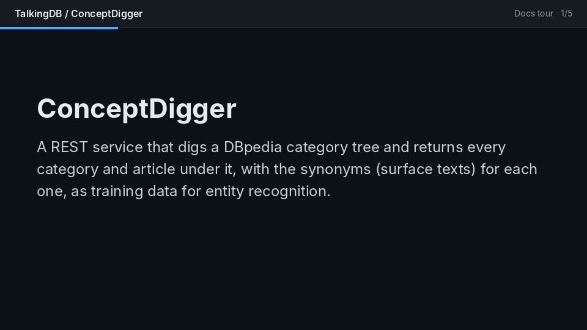

<!-- short-readme -->
<h1 align="center">ConceptDigger</h1>

<p align="center"><b>Dig a Wikipedia category and get every member with every name it goes by.</b></p>

<p align="center"><a href="#try-it">Try it</a> · <a href="docs/concepts.md">Concepts</a> · <a href="docs/troubleshooting.md">Troubleshooting</a> · <a href="docs/reference.md">Full reference</a></p>

<p align="center"><a href="https://github.com/TalkingDB/ConceptDigger/stargazers"></a> <a href="https://www.gnu.org/licenses/agpl-3.0.html"></a></p>

<p align="center">
  
</p>
<p align="center"><sub>The values are the anchors the live tests check in <code>tests/debug_data</code>, recorded from real digs. What each source means is in <a href="docs/concepts.md">Concepts</a>.</sub></p>

A [REST](https://developer.mozilla.org/en-US/docs/Glossary/REST) service that walks a [DBpedia](https://www.dbpedia.org/about/) category tree and returns each category and article with its synonyms, and says where each synonym came from. The output trains [named entity recognition](https://en.wikipedia.org/wiki/Named-entity_recognition).

## What it does

- **Dig** a category to the depth you choose ([concepts](docs/concepts.md#wikipedia-categories)).
- **Name** every member: labels, alternate names, redirects and disambiguation pages ([surface texts](docs/concepts.md#surface-texts-every-name-for-a-thing)).
- **Cache** what it found, so the second dig is fast ([hydration and the cache](docs/concepts.md#hydration-and-the-cache)).

## Try it

```bash
./start.sh                                   # Docker, port 5007
curl -X POST http://localhost:5007/api/v1/dig -H "Content-Type: application/json" \
  -d '{"categories": ["Category:Food_ingredients"], "max_depth": 1}'
```

The first dig is slow on purpose: about two calls a second, to respect DBpedia.

## Where it fits

Feeds synonyms to [package-named-entity-linker](https://github.com/TalkingDB/package-named-entity-linker) and categories to [knowledge-source-api](https://github.com/TalkingDB/knowledge-source-api).

## Learn more

| Page | Read it to |
| :--- | :--- |
| [Concepts](docs/concepts.md) | learn the ideas in plain words |
| [Troubleshooting](docs/troubleshooting.md) | fix a problem |
| [Full reference](docs/reference.md) | read everything that used to be on this page |
| [All docs](docs/README.md) | see every page |

## Support TalkingDB

If ConceptDigger saved you time, please [give it a star](https://github.com/TalkingDB/ConceptDigger) ⭐. Stars help other developers find the project.

Found a bug, or a document it gets wrong? [Open an issue](https://github.com/TalkingDB/ConceptDigger/issues/new). We are always here to help and open to a conversation. Explore the TalkingDB applications at [talkingdb.io](https://talkingdb.io/#applications).

## License

GNU Affero General Public License v3. See `LICENCE-AGPL-3.0.txt`.
