# Concepts in plain words

[Docs home](README.md) › Concepts

ConceptDigger collects every name a set of things goes by, starting from one Wikipedia category. This page explains the ideas behind it, one at a time, with the `Category:Food_ingredients` example the README uses.

## Wikipedia categories

Wikipedia files its articles into [categories](https://en.wikipedia.org/wiki/Help:Category). A category holds articles and smaller categories:

<picture>
  <source media="(prefers-color-scheme: dark)" srcset="images/part-of-a-wikipedia-category-tree-dark.svg">
  
</picture>

Diagram source: [part-of-a-wikipedia-category-tree.mmd](diagrams/part-of-a-wikipedia-category-tree.mmd). Edit it and re-render with the steps in [docs/diagrams](diagrams/README.md).

In words: categories hold sub-categories and articles; digging means walking down this tree and collecting what you find. (A simplified picture: the real category holds many more.)

## It is a graph, not a tree

A category can have several parents, and following parents can lead back to where you started (a **cycle**). So a walk that never remembers where it has been can loop forever. ConceptDigger keeps a set of the nodes it has already visited ([graph_store.py](../concept_digger/graph_store.py)), so each node is collected once. It also means a category's members are not always *kinds of* the category: "Finance by country" holds countries' finance articles, not kinds of finance.

## DBpedia and SPARQL

| Term | Plain meaning |
| :--- | :--- |
| [DBpedia](https://www.dbpedia.org/about/) | Wikipedia's facts, extracted into a database that programs can query |
| [SPARQL](https://www.w3.org/TR/sparql11-query/) | The query language for such databases, as SQL is for tables |
| SPARQL endpoint | A web address that answers SPARQL queries; DBpedia's public one is `https://dbpedia.org/sparql` |
| `skos:broader` | DBpedia's link from a sub-category to its parent category ([SKOS](https://www.w3.org/TR/skos-primer/)) |
| `dct:subject` | DBpedia's link from an article to a category it is in ([Dublin Core](https://www.dublincore.org/specifications/dublin-core/dcmi-terms/terms/subject/)) |

ConceptDigger asks the endpoint small questions instead of loading DBpedia's dump files: "does this category exist?", "what are its sub-categories?", "what are its articles?", "what names does this article have?".

## Surface texts: every name for a thing

A **surface text** is any string people use for an entity. ConceptDigger collects four kinds, and says which kind each one is in `how_this_record`:

| Kind | Where it comes from | Example for Ben oil |
| :--- | :--- | :--- |
| `rdfs:label` | The article's title | ben oil |
| Alternate names | `dbo:alias`, `dbp:name`, `dbp:alternateName`, `foaf:name` | (when the page lists them) |
| `redirect` | Wikipedia [redirects](https://en.wikipedia.org/wiki/Wikipedia:Redirect): other titles that lead to the article | behen oil, oil of ben |
| `disambiguation` | [Disambiguation pages](https://en.wikipedia.org/wiki/Wikipedia:Disambiguation) that list the article | |

These are the synonyms that [named entity recognition](https://en.wikipedia.org/wiki/Named-entity_recognition) (finding names of things in text) and search need: a user who types "behen oil" should find Ben oil. Because every name records how it was found, each synonym keeps its **provenance**.

## Hydration and the cache

**Hydrating** a node means fetching what DBpedia knows about it. There are two kinds:

<picture>
  <source media="(prefers-color-scheme: dark)" srcset="images/how-a-dig-uses-the-cache-dark.svg">
  
</picture>

Diagram source: [how-a-dig-uses-the-cache.mmd](diagrams/how-a-dig-uses-the-cache.mmd). Edit it and re-render with the steps in [docs/diagrams](diagrams/README.md).

In words: fetch only what is missing, remember it, and answer from memory next time.

A node is marked `structure_hydrated` or `synonyms_hydrated` only when every lookup for it worked, so a half fetched node is fetched again on the next dig. Calls are spaced about half a second apart (`SPARQL_MIN_INTERVAL_SECONDS`) to respect DBpedia's limits, which is why a first dig is slow and a repeat dig is fast.

## Depth

`max_depth: 0` returns the seed's direct children; each extra level goes one level further down. The walk always goes into sub-categories, even when you ask only for articles, because articles can sit deeper. `MAX_DEPTH_HARD_CAP` (default 6) is the deepest a request may go.

## Who uses it

TalkingDB's ontology builder uses it to turn a domain's Wikipedia categories into ontology entities with alternative labels, and TalkingDB's knowledge gateway calls it as its Wikipedia source.

---

**Related:** [Docs home](README.md) · [Troubleshooting](troubleshooting.md) · [API in the README](reference.md#api)
